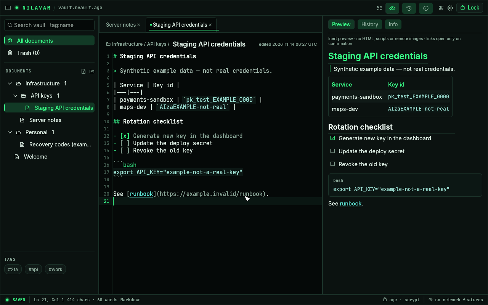
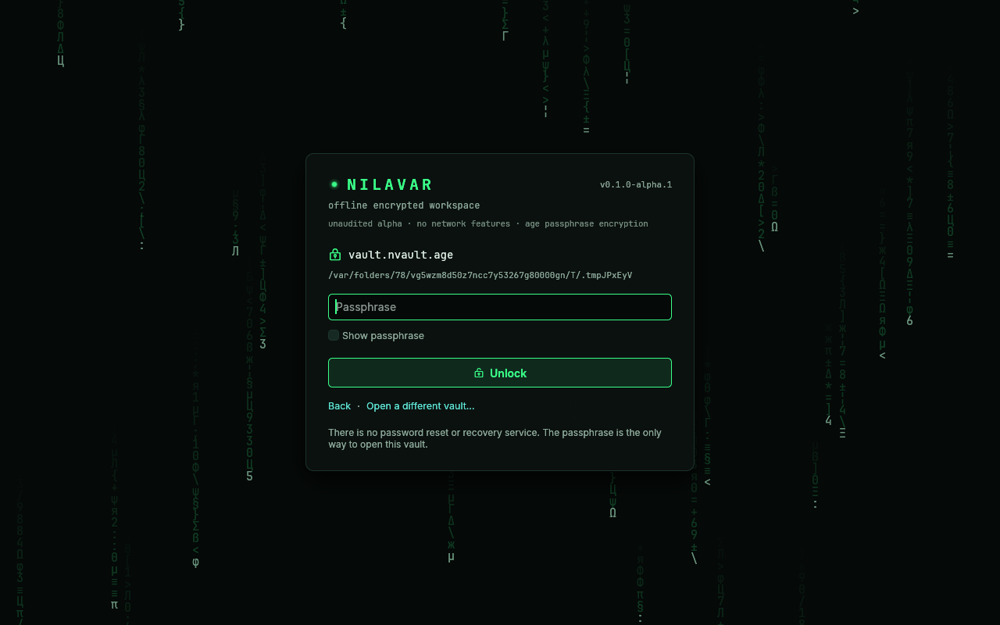
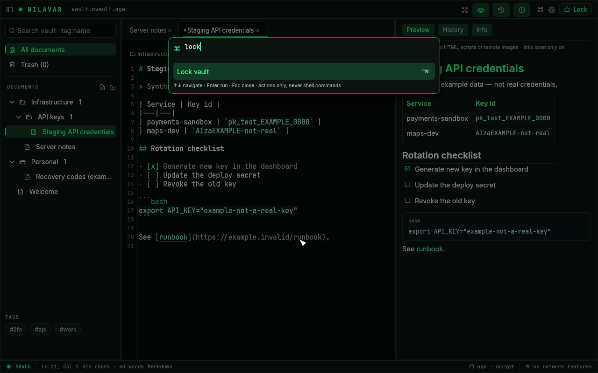
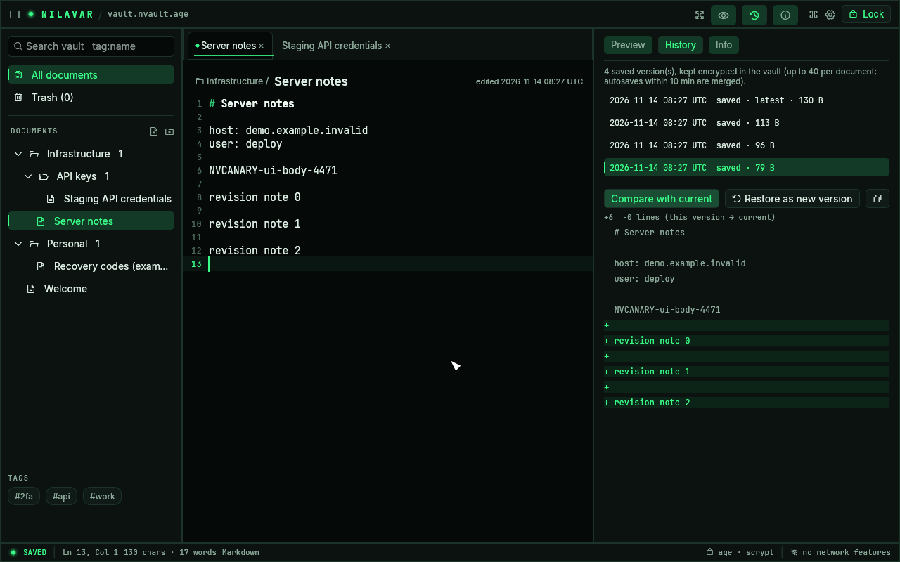
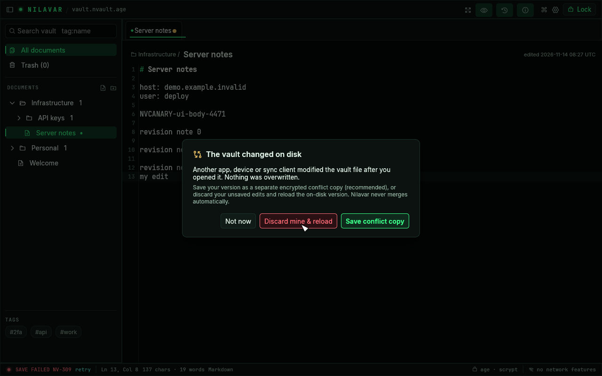

# Nilavar

**An offline, encrypted workspace for confidential text** — Markdown notes,
passwords written in notes, recovery codes, API credentials and text key
files — in a fast native desktop app with a Matrix-inspired terminal look.

> **Status: unaudited alpha (`0.1.0-alpha.1`).** Nilavar has not been
> independently reviewed. Keep independent backups of anything important and
> read [SECURITY.md](SECURITY.md) and [docs/THREAT_MODEL.md](docs/THREAT_MODEL.md)
> before relying on it.



## What it is

- **One portable encrypted file.** A vault is a single standard
  [age](https://age-encryption.org) passphrase-encrypted file
  (`*.nvault.age`). Titles, folders, tags, text, history, trash and
  vault preferences all live *inside* the encryption. Copy the file to a
  cloud drive or USB stick, install Nilavar on another computer, and open it
  with the same passphrase — no account, no server, no device key.
- **A real editor.** Tabs, folders, tags, global search, find & replace,
  command palette, quick switcher, Markdown highlighting and an inert
  preview, list continuation, line numbers that stay right under soft wrap,
  focus mode, undo/redo.
- **Encrypted history, trash and recovery.** Saved versions with diff and
  restore, a trash you purge explicitly, encrypted last-known-good recovery
  copies, encrypted backups and restore-as-new.
- **Careful about leaks.** No networking code at all, and on macOS the kernel
  is told to deny every socket for the process. No telemetry, no plaintext
  caches or indexes on disk, clipboard auto-clear, auto-lock (idle, sleep,
  screen lock), redacted diagnostics.
- **Recoverable without the app.** `age -d vault.nvault.age` yields a
  documented JSON file ([docs/FORMAT.md](docs/FORMAT.md)). A small CLI,
  `nilavar-cli`, verifies, exports and recovers vaults.

| | |
|---|---|
|  |  |
|  |  |

All screenshots use synthetic data and are rendered by the automated UI
tests (`crates/vault-desktop/tests/ui_flows.rs`).

## Install

### From source (all platforms)

Requirements: [Rust](https://rustup.rs) (the pinned toolchain in
`rust-toolchain.toml` is installed automatically), a C toolchain, and on
Linux the usual windowing headers
(`libxkbcommon-dev libwayland-dev libxcb-render0-dev libxcb-shape0-dev libxcb-xfixes0-dev`).

```bash
git clone <this repository> nilavar && cd nilavar
cargo install --locked --path crates/vault-desktop   # installs `nilavar`
cargo install --locked --path crates/vault-cli       # installs `nilavar-cli`
nilavar
```

### macOS app bundle

```bash
./scripts/package-macos.sh        # builds dist/Nilavar.app (+ zip, checksums, SBOM)
cp -R dist/Nilavar.app /Applications/
```

The bundle is **not signed with a Developer ID or notarized** (it carries an
ad-hoc signature only). On first launch, right-click the app → *Open*, or run
`xattr -dr com.apple.quarantine /Applications/Nilavar.app`. Signing and
notarization steps are in [docs/RELEASING.md](docs/RELEASING.md).

### Linux / Windows

```bash
./scripts/package-linux.sh        # dist/nilavar-<ver>-linux-<arch>-UNSIGNED.tar.gz (+ install.sh)
pwsh ./scripts/package-windows.ps1
```

Linux and Windows builds compile in CI and their tests run there, but they
have **not been manually exercised** on real desktops yet; see the matrix in
[docs/TESTING.md](docs/TESTING.md).

## Using it

1. **Create a vault**: choose a location (the neutral default name is
   `vault.nvault.age`) and a passphrase. Use *Suggest a passphrase* for
   seven random words. There is **no password reset**.
2. **Write**: `⌘N` new document, `⌘P` go to document, `⇧⌘P` command
   palette, `⌘F` find, `⌥⌘F` replace, `⇧⌘F` search the vault, `⌘E`
   preview, `⌘\` sidebar, `⇧⌘\` focus mode, `⇧⌘L` lock (Ctrl instead of ⌘
   on Windows/Linux).
3. **Save**: changes are autosaved (debounced, encrypted); `⌘S` always
   saves now. The status bar shows the real save state.
4. **Move between computers**: copy the vault file (for example to a cloud
   drive). Nilavar detects if the file changed on disk and never silently
   overwrites — it offers an encrypted conflict copy.

### Recovery CLI

```bash
nilavar-cli verify vault.nvault.age                 # decrypt + validate, print counts only
nilavar-cli list vault.nvault.age                   # ids/sizes (titles only with --titles)
nilavar-cli export vault.nvault.age --doc <id> --out note.txt.age      # age-encrypted
nilavar-cli export vault.nvault.age --doc <id> --out note.md --plaintext   # asks you to confirm
nilavar-cli recover vault.nvault.age --to-vault restored.nvault.age
nilavar-cli backup vault.nvault.age --out backup.nvault.age
nilavar-cli change-passphrase vault.nvault.age
```

Passphrases are read from the terminal (or one per line with
`--passphrase-stdin`), never from arguments or environment variables.
Recovered plaintext is never printed to standard output.

## Documentation

| Document | Contents |
|---|---|
| [SECURITY.md](SECURITY.md) | Security properties, capability matrix, reporting vulnerabilities |
| [docs/THREAT_MODEL.md](docs/THREAT_MODEL.md) | Assets, adversaries, in/out of scope, residual risks |
| [docs/FORMAT.md](docs/FORMAT.md) | File format, payload schema, limits |
| [docs/RECOVERY.md](docs/RECOVERY.md) | Recovery checklist, independent recovery with age/rage |
| [docs/PRIVACY.md](docs/PRIVACY.md) | What is stored where, what is observable |
| [docs/DECISIONS.md](docs/DECISIONS.md) | Design decisions and their reasons |
| [docs/TESTING.md](docs/TESTING.md) | Test suites and the implemented / tested / deferred matrix |
| [docs/DEPENDENCIES.md](docs/DEPENDENCIES.md) | Crypto dependency status, accepted advisories, unsafe code |
| [docs/THIRD_PARTY_LICENSES.md](docs/THIRD_PARTY_LICENSES.md) | Crate license inventory |
| [docs/RELEASING.md](docs/RELEASING.md) | Release checklist, signing, reproducible builds |
| [docs/ROADMAP.md](docs/ROADMAP.md) | Deliberately excluded features |
| [CONTRIBUTING.md](CONTRIBUTING.md) | Development setup and rules for handling secrets |

## Project layout

```
crates/vault-core     document model, age adapter, validation, storage, history, search, diagnostics (no GUI, no unsafe)
crates/vault-desktop  egui/eframe application
crates/vault-cli      nilavar-cli recovery and verification tool
fuzz/                 cargo-fuzz targets with synthetic seeds
scripts/              packaging and repository checks
docs/                 documentation and synthetic screenshots
```

## License

MIT — see [LICENSE](LICENSE). Bundled fonts (JetBrains Mono, Inter: SIL OFL
1.1; Phosphor Icons: MIT) and the EFF wordlist (CC BY 3.0 US) keep their own
licenses; see `crates/vault-desktop/assets/fonts/NOTICE.md` and
`crates/vault-core/data/README.md`.
