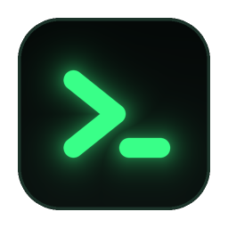
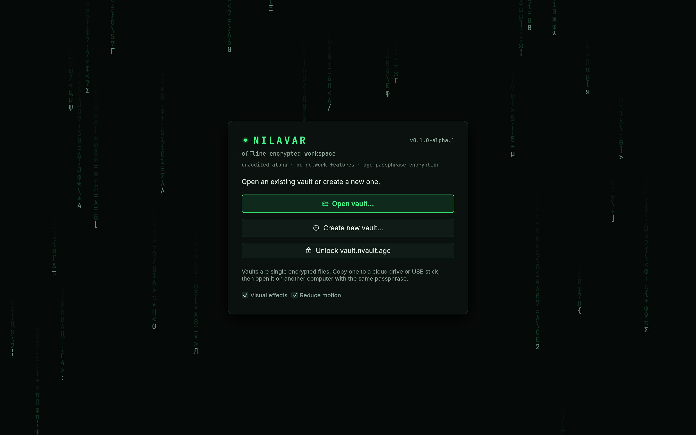
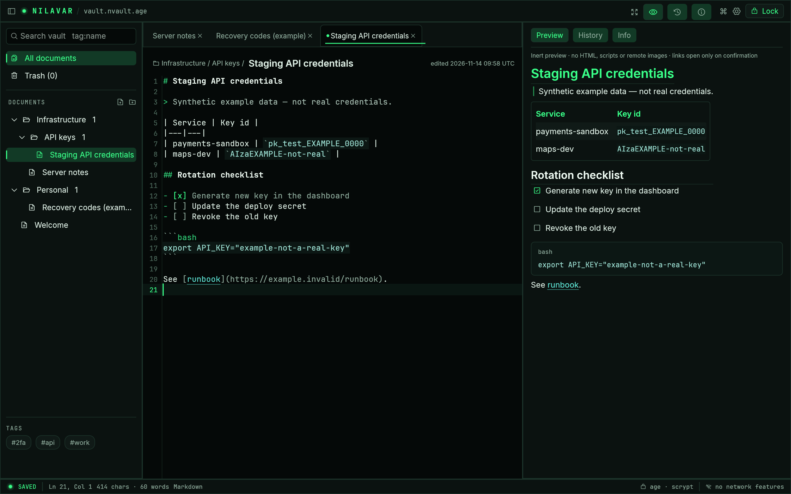
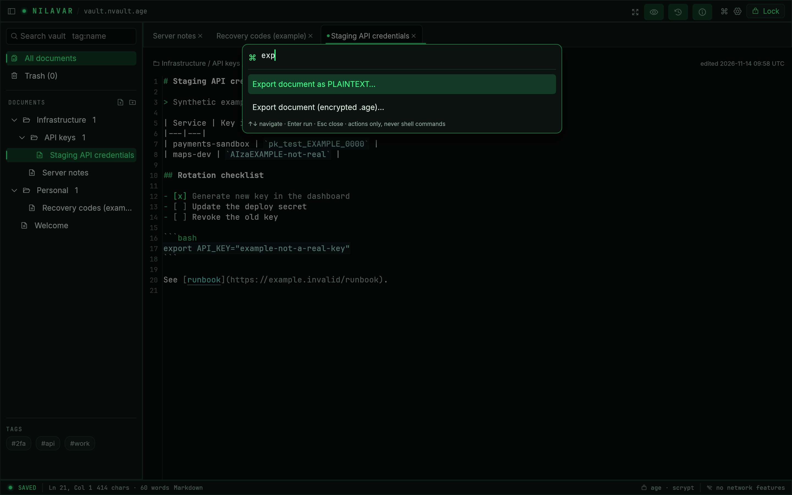
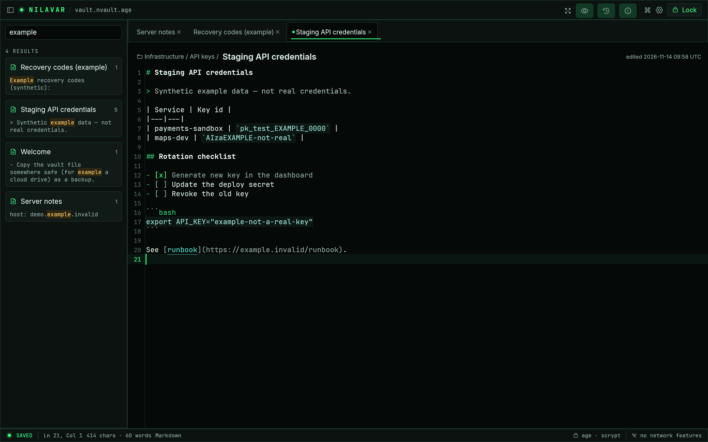
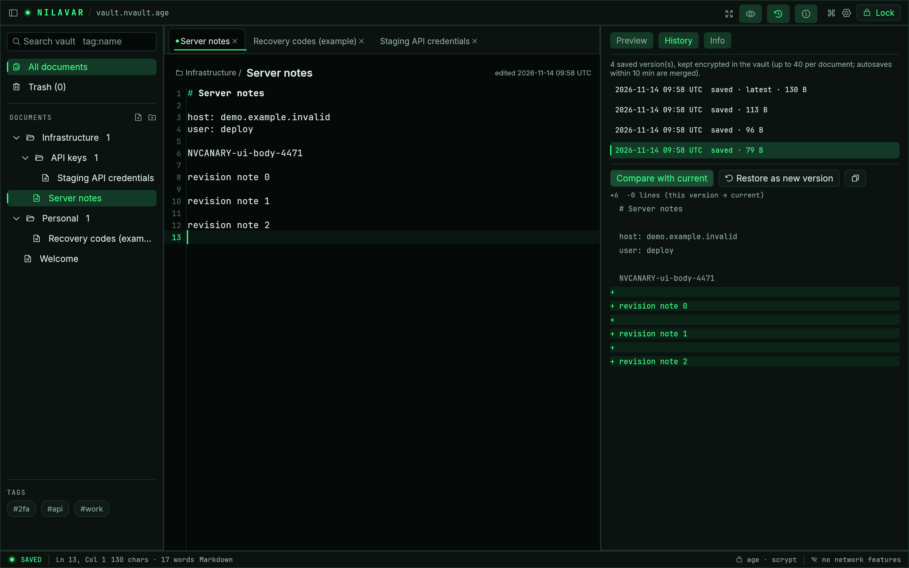
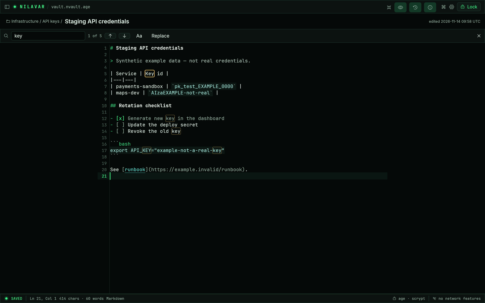
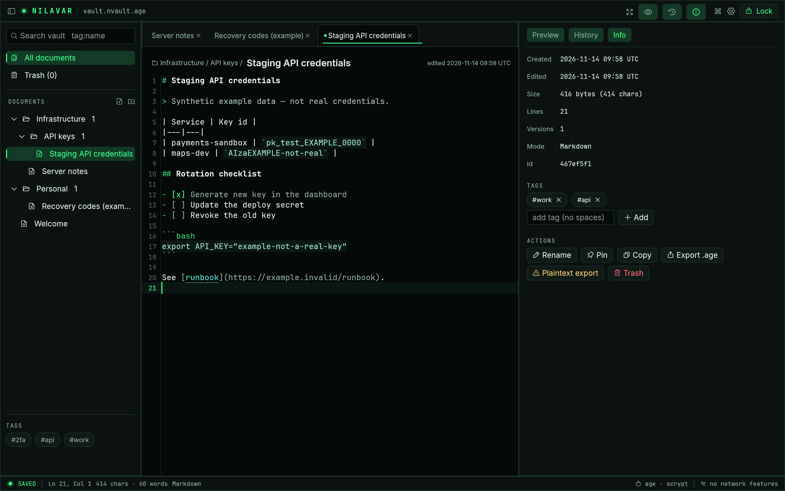
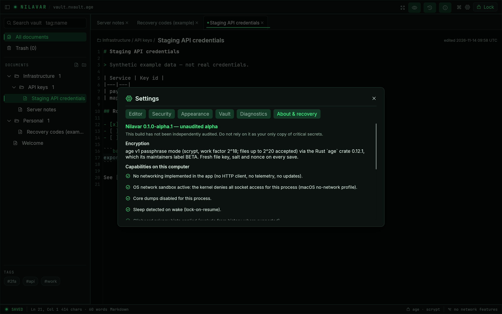
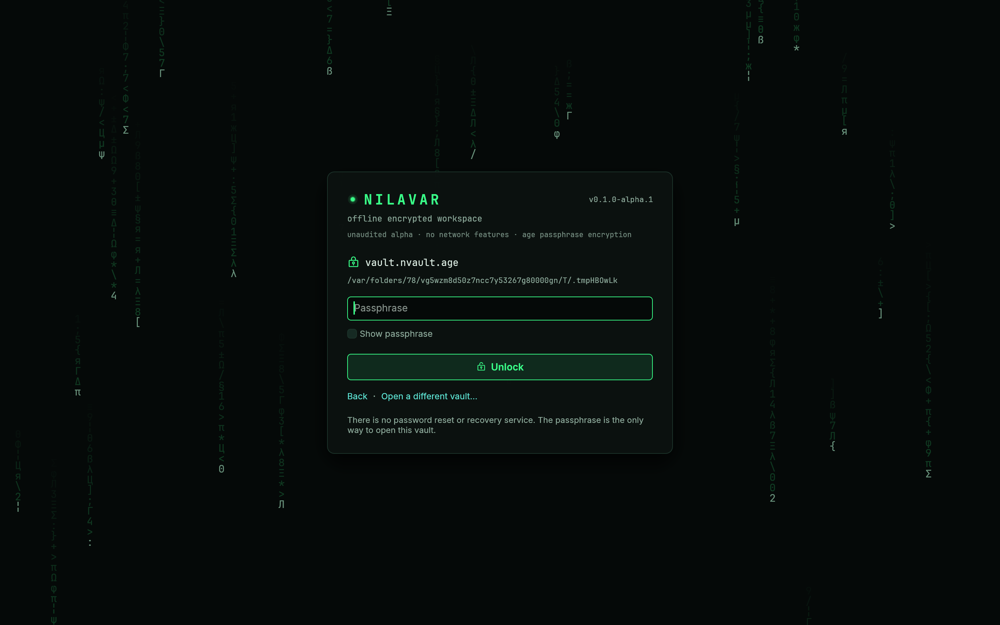

<div align="center">



# NILAVAR

**Your secrets, in one encrypted file. Offline. Forever.**

A private notebook for passwords, recovery codes, API keys and notes that
never touches the internet. No accounts. No cloud. No servers to fail.

<br>

[-39FF88?style=for-the-badge&logo=apple&logoColor=black&labelColor=0B1210)](https://github.com/Armur-Ai/nilavar/releases/latest/download/Nilavar-macOS-universal.dmg)
[-39FF88?style=for-the-badge&logo=windows&logoColor=black&labelColor=0B1210)](https://github.com/Armur-Ai/nilavar/releases/latest/download/Nilavar-Windows-x64.exe)
<br>
[](https://github.com/Armur-Ai/nilavar/releases/latest/download/nilavar_amd64.deb)
[](https://github.com/Armur-Ai/nilavar/releases/latest/download/nilavar-x86_64.pkg.tar.zst)
[](https://github.com/Armur-Ai/nilavar/releases/latest/download/nilavar-linux-x86_64.tar.gz)

<sub>All downloads and checksums: <a href="https://github.com/Armur-Ai/nilavar/releases/latest">latest release</a> · New here? Read the <a href="docs/USER_GUIDE.md"><b>User Guide</b></a> (no tech skills needed)</sub>

<br><br>



</div>

> <sub>**Why "Nilavar"?** *Nilavara* (നിലവറ) is Malayalam for an underground
> vault. Beneath the Sree Padmanabhaswamy Temple in Thiruvananthapuram lie
> the temple's *nilavaras* — sealed chambers whose treasure stayed hidden for
> centuries, and one of which, Vault B, has famously never been opened. This
> app borrows the name for the same idea: what you put inside stays sealed
> until the right key is presented.</sub>

---

## ⚡ Killer features

- 🔒 **One file holds everything.** Every note, title, folder, tag, version
  and deleted item lives inside a single encrypted `.nvault.age` file.
  Nothing readable is left lying around on disk.
- 📡 **Zero internet. Zero accounts.** Nilavar contains no networking code
  at all — no sync servers, telemetry, update checks or crash uploads. On
  macOS it goes further and asks the operating system's kernel to block
  every network connection the app could ever make.
- 🧳 **Your data travels as a file.** Copy the vault to a USB stick, Google
  Drive, Dropbox or an email to yourself, open it on any computer with the
  same passphrase. No device registration, no "approve this login".
- 🛡️ **Serious, modern encryption.** The vault is a standard
  [age](https://age-encryption.org) file: 256-bit keys, ChaCha20-Poly1305
  authenticated encryption, and scrypt to make every passphrase guess
  deliberately slow and memory-hungry. Fresh keys on every single save.
- 🕰️ **Nothing gets lost.** Encrypted version history with side-by-side
  diffs and one-click restore, a trash you empty on purpose, automatic
  encrypted recovery copies, encrypted backups, and crash-safe saving.
- 🤝 **Never silently overwrites.** Edited the same vault on two computers?
  Nilavar detects it and saves your version as a separate encrypted
  conflict copy — nothing is ever clobbered.
- 🚪 **Locks itself.** On idle, on sleep, when your screen locks, or with
  one keystroke — and copied passwords are wiped from the clipboard after 30
  seconds.
- ⌨️ **A real editor, built for the keyboard.** Tabs, folders, tags, vault-wide
  search, find & replace, command palette, quick switcher, Markdown
  highlighting with a safe live preview, checklists, focus mode.
- 🖥️ **Runs everywhere.** macOS (Apple Silicon & Intel), Windows, Kali,
  Debian, Ubuntu, Arch, BlackArch — plus a recovery command-line tool.
- 🧾 **Open source, MIT licensed, auditable.** No lock-in: the file format is
  documented and opens with the standard `age` tool, even without Nilavar.

---

## ☢️ Built to outlast (even the apocalypse)

Most "secure" apps are a login page in front of someone else's server.
When the company shuts down, gets breached, changes its pricing or the
internet goes dark, your data goes with it. Nilavar is built the other way
around:

- **No servers to go down.** There's nothing to shut off. The app runs on
  your machine and needs nothing from the outside world — ever.
- **No subscription, no account, no expiry.** Download it once and it works
  offline indefinitely.
- **Works with zero connectivity.** No Wi-Fi, no cell signal, air-gapped
  laptop in a bunker — it doesn't care.
- **Your data is one portable file.** Keep copies on a USB stick, an old
  laptop, a cloud drive and a drive in a fireproof box. Any copy plus your
  passphrase brings everything back.
- **Readable without us.** The vault uses the open, widely implemented age
  format with a documented layout ([FORMAT.md](docs/FORMAT.md)). If Nilavar
  vanished tomorrow, `age -d vault.nvault.age` would still give you your notes.
- **No secret held hostage.** No recovery service, no backdoor, no master
  key that could be stolen, subpoenaed or lost. Only your passphrase opens
  your vault.

---

## 🖼️ A look inside

<p align="center">
  
  <br><sub><b>The workspace</b> — folders and tags on the left, a keyboard-first editor with line numbers and Markdown highlighting, and a safe live preview (no web view, no remote images, links only open after you confirm).</sub>
</p>

<table>
<tr>
<td width="50%"><br><sub><b>Command palette</b> (⇧⌘P) — every action is a few keystrokes away. It only runs app actions, never shell commands.</sub></td>
<td width="50%"><br><sub><b>Search the whole vault</b> — titles, tags and text with highlighted snippets, computed in memory and never written to disk.</sub></td>
</tr>
<tr>
<td><br><sub><b>Version history</b> — compare any saved version with the current text and restore it in one click. History is encrypted too.</sub></td>
<td><br><sub><b>Focus mode + find & replace</b> — distraction-free writing with match highlighting and counts.</sub></td>
</tr>
<tr>
<td><br><sub><b>Info & tags</b> — metadata, tags and per-note actions: encrypted export, pin, copy with auto-clear.</sub></td>
<td><br><sub><b>Honest security panel</b> — shows exactly which protections are active on <i>your</i> computer, with no fake indicators.</sub></td>
</tr>
</table>

<p align="center">
  
  <br><sub><b>Locked</b> — the workspace is masked the instant it locks. All screenshots use made-up example data.</sub>
</p>

---

## 🚀 Get started in 60 seconds

1. **Download** for your system with the buttons above and open the app
   (unsigned builds: see the [User Guide](docs/USER_GUIDE.md#2-install-nilavar)
   for the one-time "open anyway" step).
2. Click **Create new vault…**, choose where to save it, and pick a
   passphrase — or let Nilavar **suggest one** (seven random words).
3. **Write the passphrase down.** There is no reset. That's the point.
4. Start writing. It saves (encrypted) automatically.

### Moving between devices

Nilavar has no cloud sync — on purpose. **You carry the encrypted file:**

```
  Laptop                              Any other computer
  vault.nvault.age  ── copy via USB / Drive / Dropbox / email ──▶  vault.nvault.age
  (encrypted)                                                     open with the SAME passphrase
```

Put the vault in a cloud-synced folder if you like — the provider only ever
sees an encrypted blob. If two computers change it at once, Nilavar keeps
both versions instead of overwriting either.

### Keyboard shortcuts

| Action | macOS | Windows / Linux |
|---|---|---|
| New note | ⌘N | Ctrl+N |
| Save now | ⌘S | Ctrl+S |
| Go to note | ⌘P | Ctrl+P |
| Command palette | ⇧⌘P | Ctrl+Shift+P |
| Find / replace | ⌘F / ⌥⌘F | Ctrl+F / Ctrl+Alt+F |
| Search whole vault | ⇧⌘F | Ctrl+Shift+F |
| Preview | ⌘E | Ctrl+E |
| Sidebar / focus mode | ⌘\ / ⇧⌘\ | Ctrl+\ / Ctrl+Shift+\ |
| Lock | ⇧⌘L | Ctrl+Shift+L |

---

## 🔐 Security, in plain words

| | |
|---|---|
| **Encryption** | [age](https://age-encryption.org) v1 passphrase mode: scrypt key derivation (2^18 work factor, ~0.3 s per unlock by design) and ChaCha20-Poly1305 with 256-bit keys. Implemented by the Rust `age` crate; Nilavar invents no cryptography. |
| **What's encrypted** | Everything: titles, folders, tags, text, history, trash, settings for the vault. |
| **What's visible** | Only the vault file's name, size and timestamps. |
| **Internet** | None. No networking code; on macOS the kernel blocks the app's network access entirely. |
| **Tamper-proof** | Any change to the file — even one flipped bit — is detected and the vault refuses to open rather than show corrupted data. |
| **Memory & clipboard** | Plaintext held in self-wiping buffers, workspace wiped on lock, clipboard auto-clear, no crash dumps. |
| **Status** | An **unaudited alpha**. 100+ automated tests, fuzzing and interop tests against the reference `age` tools — but no independent audit yet. Keep backups. |

Details: [SECURITY.md](SECURITY.md) · [Threat model](docs/THREAT_MODEL.md) ·
[Privacy](docs/PRIVACY.md) · [Recovery](docs/RECOVERY.md)

---

## 🛠️ For developers

```bash
git clone https://github.com/Armur-Ai/nilavar && cd nilavar
./scripts/install.sh            # macOS/Linux user-level install from source
cargo test --workspace          # 100+ tests incl. headless UI flows
```

- Rust workspace: `vault-core` (format, crypto adapter, storage, history,
  search — no GUI, no `unsafe`), `vault-desktop` (egui/eframe app),
  `vault-cli` (`nilavar-cli` recovery tool), `fuzz/`.
- `site/` is the project website: a static, self-contained page (no
  third-party requests) ready for Cloudflare Pages — see
  [`site/README-DEPLOY.md`](site/README-DEPLOY.md).
- Arch users can also build from source with
  [`packaging/arch/PKGBUILD`](packaging/arch/PKGBUILD) (`makepkg -si`).
- Docs: [FORMAT](docs/FORMAT.md) · [DECISIONS](docs/DECISIONS.md) ·
  [TESTING](docs/TESTING.md) · [DEPENDENCIES](docs/DEPENDENCIES.md) ·
  [RELEASING](docs/RELEASING.md) · [ROADMAP](docs/ROADMAP.md) ·
  [CONTRIBUTING](CONTRIBUTING.md)

### Recovery CLI

```bash
nilavar-cli verify vault.nvault.age           # check it opens; prints counts only
nilavar-cli backup vault.nvault.age --out backup.nvault.age
nilavar-cli recover vault.nvault.age --to-vault restored.nvault.age
nilavar-cli change-passphrase vault.nvault.age
```

---

<div align="center">

**MIT licensed.** Fonts: JetBrains Mono & Inter (SIL OFL 1.1) · Icons:
Phosphor (MIT) · Passphrase words: EFF wordlist (CC BY 3.0 US).

<sub>Built with care by Armur AI and contributors. No secrets were harmed in the making of these screenshots — every one uses made-up data.</sub>

</div>
